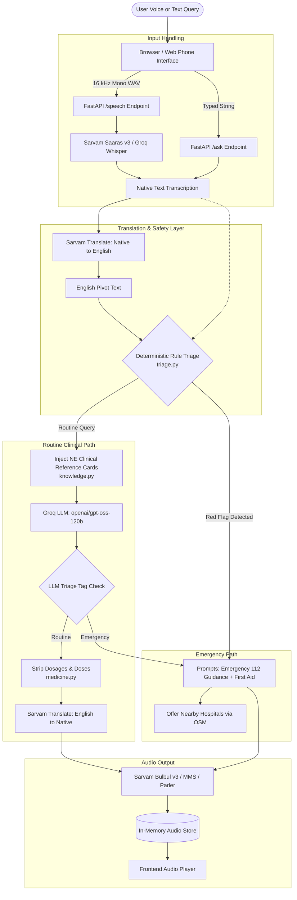

# Aarogya Saathi

**Your health. Your language. Your companion.**

[](https://www.python.org/downloads/)
[](https://fastapi.tiangolo.com)
&nbsp;[`Tests: 95 passing`](#testing--verification)

> **Live Application**: [https://aarogya-saathi.onrender.com](https://aarogya-saathi.onrender.com)  
> *Note: Hosted on Render's free tier. If the instance has been idle, please allow 30–60 seconds for the service to wake up.*

---

## Overview

**Aarogya Saathi** is an AI-powered, voice-first health information companion designed specifically for rural and underserved communities in North East India. 

### The Problem
In remote and hilly regions of North East India, access to timely healthcare advice is hindered by geographic isolation, linguistic fragmentation, and limited digital literacy. Many residents speak regional languages that standard conversational tools support poorly or not at all. Furthermore, generic online searches often provide complex medical jargon, incorrect self-medication advice, or fail to prioritize urgent red-flag symptoms.

### What Aarogya Saathi Does
Aarogya Saathi bridges this gap by providing an accessible, multi-lingual health companion that:
- Accepts **voice or typed questions** in regional languages.
- Translates queries and consults an LLM grounded with **North East-specific public health guidance** (e.g., malaria, Japanese encephalitis, dengue, scrub typhus, waterborne illnesses, and maternal danger signs).
- Delivers answers back in **simple, spoken words** in the user's native tongue.
- Strictly executes **deterministic safety checks before any AI processing** to intercept life-threatening emergencies and provide instant first-aid advice alongside national emergency numbers (112, 108).
- Discovers **nearby healthcare facilities** using live OpenStreetMap data, verified local listings, and an offline directory fallback.
- Offers an experimental **camera-based visual symptom inspection** that strips image metadata, evaluates photos in memory, and returns cautious observations.

### Prototype Status & Long-Term Vision
- **Current Status**: Aarogya Saathi is currently implemented as a **working web application prototype**. To ensure an intuitive experience for non-technical users, it features an interactive interface inspired by a rugged feature-phone handset, with tactile controls, an LCD display, audio playback, and a side diagnostic panel.
- **Future Vision**: The long-term vision is to deliver Aarogya Saathi as a **direct phone-call dial-in (IVR) service** over standard cellular networks. This will allow any user with a basic GSM feature phone to dial a toll-free number and receive spoken medical guidance without needing a smartphone, mobile web browser, or high-speed data connection.

---

## Features

### 1. Multilingual AI-Powered Health Assistance
- **Culturally & Regionally Contextualized**: Augments LLM prompts with curated public-health guidance cards covering high-prevalence North East health conditions without prescribing medication.
- **Explain Simply ("Simpler Words")**: Users can request a simpler explanation (via key **5** or the simpler endpoint) if medical concepts remain difficult to understand.
- **Prescription & Dosage Filtering**: A dedicated filtering module (`medicine.py`) identifies and strips medication dosages and administration quantities to protect users against unguided self-medication.
- **Session Memory**: In-memory conversational state allows natural follow-up questions within an active session.

### 2. Voice Input and Speech Capabilities
Aarogya Saathi integrates dedicated speech models and maintains an honest, verifiable language registry:

| Language | Speech Input (STT) | Translation Engine | Text-to-Speech (TTS) | Current Status |
|---|---|---|---|---|
| **Hindi** (`hi-IN`) | Sarvam Saaras v3 / Whisper | Sarvam Translate | Sarvam Bulbul v3 | Fully supported (Voice in & out) |
| **English** (`en-IN`) | Sarvam Saaras v3 / Whisper | Direct (English pivot) | Sarvam Bulbul v3 | Fully supported (Voice in & out) |
| **Bengali** (`bn-IN`) | Sarvam Saaras v3 / Whisper | Sarvam Translate | Sarvam Bulbul v3 | Fully supported (Voice in & out) |
| **Assamese** (`as-IN`) | Sarvam Saaras v3 | Sarvam Translate | Cloned Voice / Meta MMS / Parler | Voice in; spoken audio requires configured voice model |
| **Nepali** (`ne-IN`) | Sarvam Saaras v3 / Whisper | Sarvam Translate | Meta MMS / Parler | Voice in; spoken audio requires configured voice model |
| **Bodo** (`brx-IN`) | Sarvam Saaras v3 | Sarvam Translate | Self-hosted Indic Parler | Voice in; text answer by default |
| **Manipuri** (`mni-IN`) | Sarvam Saaras v3 | Sarvam Translate | Self-hosted Indic Parler | Voice in; text answer (script flagged for review) |
| **Khasi, Garo, Mizo, Kokborok, Nagamese** | *Unavailable* | *Unavailable* | *Unavailable* | **Explicitly marked unavailable** in the UI with honest explanations rather than faking support |

### 3. Image-Based Visual Symptom Check (Camera Prototype)
- **Interactive 3D Handset Flip**: Pressing **6** (or clicking Camera) flips the simulated phone to reveal the rear camera module and viewfinder.
- **Camera Capture & Upload**: Supports live browser camera streaming (`getUserMedia`) with flash simulation and torch activation, as well as static photo upload.
- **Privacy-by-Design**: Images are decoded, oriented upright, scaled to ≤1280 px, and stripped of all EXIF/GPS metadata via Pillow. Photos are processed purely in RAM and never written to disk or stored in server logs.
- **Cautious Vision Analysis**: Uses Groq Vision (`qwen/qwen3.8-27b`) with strict safety instructions. Emergency signals in user notes immediately abort image transmission and redirect to emergency protocols. Detailed documentation is available in [`docs/CAMERA.md`](docs/CAMERA.md).

### 4. GPS & Nearby Healthcare Facility Discovery
- **Live OpenStreetMap Lookup**: Queries the Overpass API for hospitals, clinics, primary health centres (PHCs), and pharmacies across expanding radial boundaries (10 km, 30 km, and 80 km).
- **Geolocation & Manual Search**: Accepts coordinates via browser GPS or text-based geocoding (town, village, district, or 6-digit PIN code) via Nominatim.
- **Distance & Directions**: Computes precise Haversine distances from the user's location and generates direct navigation links.
- **SQLite Local Caching**: Caches Overpass queries and Nominatim geocode lookups locally for 7 days to conserve upstream bandwidth and improve responsiveness.
- **Offline Directory Fallback**: If OpenStreetMap is disabled or unreachable, the system automatically falls back to an offline directory (`backend/app/data/places.csv`) containing approximate coordinates for North East towns and PIN codes.
- **Team-Verified Facility Registry**: Incorporates vetted facility data (`backend/app/data/verified_facilities.csv`) with contact numbers and confirmed emergency services.

### 5. Deterministic Emergency Triage & Safety Architecture
- **Rule-Based Triage Runs First**: A dedicated multilingual rule engine (`triage.py`) scans native-language and English-translated text **before any LLM invocation**.
- **Instant Emergency Handling**: Recognizes red flags (chest pain, severe bleeding, stroke signs, breathing distress, snakebite, poison, pregnancy complications, or self-harm) and bypasses the AI completely to deliver fixed 112 guidance, immediate first-aid advice, and emergency hospital recommendations.
- **Dual-Layer Fallback**: The LLM includes a secondary `<TRIAGE>` classification net. If the LLM identifies an emergency missed by keywords, it elevates the response; however, AI can **never downgrade** a rule-triggered emergency.
- **Dedicated Emergency Channel**: Pressing **0** or calling the emergency endpoint immediately returns local helpline numbers (112, 108, 102, 14416) without AI dependency.

---

## Screenshots & Interface Walkthrough

The application features a responsive split-pane layout designed for both mobile and desktop screens:

- **Left Pane (Handset Simulator)**: A tactile virtual phone interface featuring an LCD display with green backlight, status bar, dynamic softkeys, dialpad (keys 0–9, \*, #), call controls, audio toggle, and rear camera viewfinder.
- **Right Pane (Inspection & Facilities Panel)**:
  - **Call Log**: Real-time diagnostic view displaying transcribed speech, intermediate English pivot, safety triage status, reference cards referenced, and timing benchmarks for every pipeline step.
  - **Hospitals**: Facility search tool with live GPS detection, text search, distance indicators, and phone links.
  - **Network**: Transparent language coverage table displaying live availability and verification statuses.

```
+---------------------------------------------------------------------------------+
|                                 AAROGYA SAATHI                                  |
|          [ Live Demo: https://aarogya-saathi.onrender.com ]                     |
+------------------------------------+--------------------------------------------+
|        VIRTUAL PHONE INTERFACE     |          DIAGNOSTIC & FACILITY PANEL       |
|                                    |                                            |
|   +----------------------------+   |   [ Call Log ]   [ Hospitals ]   [ Network ]|
|   | [LCD] HEARD: Fever 2 days  |   |                                            |
|   | ANSWER: Drink clean water  |   |   Turn #1 Diagnostics:                     |
|   |         and rest...        |   |   - Input: "मुझे दो दिन से बुखार है"          |
|   +----------------------------+   |   - English Pivot: "I have had a fever..." |
|                                    |   - Safety Triage: ROUTINE (Rule Check OK) |
|   [–] Softkey      [C] Clear       |   - Clinical Topic: Fever (general)        |
|   [ CALL ]         [ END ]         |   - Latency: STT 420ms | LLM 880ms        |
|   [ 1 ][ 2 ][ 3 ]                  |                                            |
|   [ 4 ][ 5 ][ 6: Camera ]          |   Healthcare Facilities (Guwahati):        |
|   [ 7 ][ 8 ][ 9 ]                  |   * Gauhati Medical College Hospital       |
|   [ * ][ 0: Emergency ][ # ]       |     Distance: 3.4 km | Emergency: Yes      |
+------------------------------------+--------------------------------------------+
```

> **Demo Recording Placeholder**:  
> A mobile video walkthrough demonstrating voice interaction, emergency triage triggering, and camera inspection will be linked here upon final release.

---

## Technology Stack

| Layer | Technologies Used | Purpose |
|---|---|---|
| **Frontend** | Vanilla JavaScript (ES6+), HTML5, CSS3 (3D Transforms), Web Audio API, MediaRecorder API, Geolocation API | Zero-dependency, lightweight, retro feature-phone simulation and real-time audio recording |
| **Backend** | Python 3.12+, FastAPI, Uvicorn, Pydantic v2, HTTPX | Asynchronous REST API, audio streaming, session management, and external service orchestration |
| **AI & LLM Services** | Groq API (`openai/gpt-oss-120b`) | Primary conversational reasoning model with low reasoning latency |
| **Vision Model** | Groq Vision (`qwen/qwen3.8-27b`) | In-memory image evaluation for visual symptom assistance |
| **Speech-to-Text (STT)** | Sarvam AI (`saaras:v3`), Groq Whisper (`whisper-large-v3-turbo`) | High-accuracy speech recognition for Indian languages and English |
| **Translation** | Sarvam Translate (`sarvam-translate:v1`) | Bidirectional regional language translation via an English pivot |
| **Text-to-Speech (TTS)** | Sarvam AI (`bulbul:v3`), Meta MMS-TTS (CPU), Indic Parler-TTS | Native-sounding voice synthesis across supported Indian languages |
| **Mapping & Facilities** | OpenStreetMap (Overpass API, Nominatim), SQLite3 | Live facility search, address geocoding, and local caching |
| **Image Processing** | Pillow (PIL) | In-memory orientation correction, resizing, and EXIF/GPS privacy stripping |
| **Deployment** | Docker, Render | Containerized deployment with automated health checks |
| **Testing** | Pytest, Playwright | Comprehensive unit, safety triage, mocked provider, and browser E2E tests |

---

## Architecture & Workflow



For in-depth architectural decisions and design considerations, refer to [`docs/architecture.md`](docs/architecture.md) and [`docs/DESIGN.md`](docs/DESIGN.md).

---

## Run Locally

### Prerequisites
- **Python**: Version 3.12 or later installed.
- **Git**: Installed and available in your shell.
- **Node.js** *(Optional)*: Required only if running Playwright browser E2E tests.

### Step 1: Clone the Repository
```bash
git clone https://github.com/sarthak-cc/Aarogya-Sathi.git
cd Aarogya-Sathi
```

### Step 2: Set Up a Python Virtual Environment
- **On Linux / macOS**:
  ```bash
  python3 -m venv .venv
  source .venv/bin/activate
  ```
- **On Windows (PowerShell)**:
  ```powershell
  python -m venv .venv
  .\.venv\Scripts\Activate.ps1
  ```

### Step 3: Install Dependencies
```bash
pip install -r requirements.txt
```

*(Optional: If you wish to enable local CPU-based Meta MMS voice synthesis for Assamese/Nepali, run `pip install -r requirements-tts.txt`)*

### Step 4: Configure Environment Variables
Copy the sample environment file:
```bash
# On Linux / macOS:
cp .env.example .env

# On Windows (PowerShell):
Copy-Item .env.example .env
```
Open `.env` in your editor and configure your API keys (see [Environment Configuration](#environment-configuration) below).

> **Graceful Degradation Note**: The application will run even if keys are omitted. Any unconfigured provider or language will simply be marked as unavailable in the UI with a clear explanatory notice.

### Step 5: Start the Development Server
```bash
cd backend
uvicorn app.main:app --reload --host 127.0.0.1 --port 8000
```

### Step 6: Access the Application
Open [http://localhost:8000](http://localhost:8000) in your web browser.  
*(Microphone and geolocation permissions are supported over `http://localhost` during local development; remote deployments require HTTPS).*

---

## Environment Configuration

Aarogya Saathi uses environment variables for external service integration. Store these in your local `.env` file (which is excluded from Git via `.gitignore`). **Never commit API keys or secret credentials to the repository.**

### Key Variables

| Variable | Required | Default Value | Description |
|---|---|---|---|
| `LLM_API_KEY` | **Yes** (for AI answers) | *(None)* | Groq API Key used for general health reasoning. Obtain a free key from the [Groq Console](https://console.groq.com/keys). |
| `SARVAM_API_KEY` | **Yes** (for Indic languages) | *(None)* | Sarvam AI Key for Indian language STT, translation, and Bulbul TTS. Obtain credits from the [Sarvam Dashboard](https://dashboard.sarvam.ai). |
| `GROQ_API_KEY` | Optional | Reuses `LLM_API_KEY` | Dedicated key for Groq Whisper STT and Vision models. |
| `LLM_MODEL` | Optional | `openai/gpt-oss-120b` | Target LLM model identifier on Groq. |
| `LLM_BASE_URL` | Optional | `https://api.groq.com/openai/v1` | Base URL for OpenAI-compatible chat completions. |
| `LLM_REASONING_EFFORT` | Optional | `low` | Reasoning effort parameter (`low`, `medium`, `high`). |
| `LLM_MAX_TOKENS` | Optional | `1200` | Maximum token completion limit. |
| `VISION_MODEL` | Optional | `qwen/qwen3.8-27b` | Model used for camera photo inspection. |
| `VISION_MAX_UPLOAD_MB` | Optional | `8` | Maximum allowable image upload size in megabytes. |
| `SARVAM_STT_MODEL` | Optional | `saaras:v3` | Speech-to-text model on Sarvam. |
| `SARVAM_TRANSLATE_MODEL`| Optional | `sarvam-translate:v1` | Translation model on Sarvam. |
| `SARVAM_TTS_MODEL` | Optional | `bulbul:v3` | Text-to-speech model on Sarvam. |
| `SARVAM_TTS_SPEAKER` | Optional | `priya` | Default speaker voice for Bulbul synthesis. |
| `SARVAM_VOICE_ID` | Optional | *(None)* | Optional cloned voice identifier for Assamese synthesis. |
| `MMS_TTS_LANGS` | Optional | *(None)* | Comma-separated list for local Meta MMS voices (e.g., `as-IN,ne-IN`). |
| `PARLER_TTS_URL` | Optional | *(None)* | Endpoint URL for a self-hosted Indic Parler-TTS server. |
| `OSM_ENABLED` | Optional | `true` | Enables live OpenStreetMap Overpass & Nominatim integration. |
| `OSM_CONTACT` | Optional | `aarogya-saathi` | Identifying email or repository URL sent in the User-Agent per OSM usage policy. |
| `DB_PATH` | Optional | `backend/app/data/aarogya.db` | Local SQLite database file for caching facility data. |

---

## Testing & Verification

Aarogya Saathi includes a rigorous test suite designed to validate safety, translation pipelines, dosage removal, and facility caching without incurring live API costs or requiring internet access.

### 1. Automated Unit & Integration Tests (Mocked Providers)
All external service calls in the unit test suite are fully mocked. You do not need API keys to execute these tests.

```bash
# Run the complete test suite from the project root:
pytest backend/tests -q
```

**Verified Test Results**:
- **95 tests passed** across all backend test modules:
  - `test_answers.py`: Conversational turns, language fallbacks, and history management.
  - `test_emergency.py`: Emergency endpoints and instant guidance logic.
  - `test_facilities.py`: Facility discovery, distance calculation, caching, and offline fallbacks.
  - `test_speech_and_languages.py`: Audio format validation and language capability matrix.
  - `test_triage.py`: Pre-LLM deterministic emergency detection across multiple languages.
  - `test_vision.py`: Image resizing, EXIF metadata removal, error states, and safety constraints.

### 2. Browser E2E Tests (Playwright)
Validates the virtual handset UI, camera flip mechanics, keypad inputs, and mock backend integration:
```bash
npm install
npm run test:camera
```

### 3. Live Provider Verification Scripts
When real API keys are configured in `.env`, verify end-to-end connectivity with external providers using the included verification scripts:
```bash
# Verify live STT, LLM, translation, and TTS providers:
python scripts/verify_live.py

# Verify live camera vision analysis:
python scripts/verify_vision_live.py
```

---

## Limitations & Medical Disclaimer

> [!WARNING]
> ### Medical & Health Disclaimer
> **Aarogya Saathi is an educational and informational prototype.**  
> - It **does not provide medical diagnoses, clinical treatment plans, or drug prescriptions**.
> - The information provided by the AI is for general public health awareness only and **cannot replace evaluation by a qualified physician, nurse, or certified healthcare professional**.
> - Aarogya Saathi **does not automatically dispatch ambulances or contact emergency services**. In the event of a medical emergency, immediately dial **112** (or local emergency numbers) or proceed to the nearest emergency room.

### Technical & Operating Limitations
- **Clinical Review**: Curated health guidance cards and translated strings must undergo continuous review by native-speaking healthcare practitioners and clinical experts.
- **Provider Quotas**: Third-party speech and language APIs operate on rate limits and usage quotas. When quotas are exhausted, the application reports service unavailability rather than guessing responses.
- **OpenStreetMap Completeness**: OpenStreetMap coverage in rural areas of North East India is actively evolving. Operating hours, emergency department availability, and telephone numbers reflect community-mapped data and may be incomplete.
- **Device Permissions**: GPS facility lookup and camera photo checks require explicit user permission in the browser.

---

## Roadmap

- [ ] **Cellular Telephony & IVR Integration**: Implement a true dial-in telephony gateway (via SIP / GSM trunking) allowing users to call from any keypad phone without needing web access.
- [ ] **Expanded North East Language Support**: Integrate emerging speech and translation models for Khasi, Garo, Mizo, Kokborok, and Nagamese as robust public models become available.
- [ ] **Offline Edge Speech Models**: Package lightweight quantized on-device speech models (e.g., Whisper quantized or ONNX) for deployment in community health kiosks with zero connectivity.
- [ ] **Community ASHA Integration**: Build an optional referral workflow enabling local ASHA (Accredited Social Health Activist) workers to review verified facility availability in their local blocks.
- [ ] **Expanded Verified Facilities Registry**: Expand phone-verified hospital and health-subcentre listings across all eight North Eastern states.

---

## Contributing & License

### Contributing
Contributions to Aarogya Saathi are warmly welcomed! Areas where help is especially appreciated:
- Native speakers reviewing translation phrasing and regional terminology.
- Healthcare professionals reviewing clinical safety prompts and regional guidance cards.
- Adding phone-verified healthcare facilities to `backend/app/data/verified_facilities.csv`.
- Improving UI accessibility and low-bandwidth optimizations.

To contribute:
1. Fork the repository.
2. Create a feature branch (`git checkout -b feature/improvement`).
3. Commit your changes and verify with `pytest backend/tests -q`.
4. Open a Pull Request with a clear description of your changes.

### License
This repository does not currently contain a formal open-source license file. All rights are reserved by the repository owner. If you intend to use, modify, or distribute this project for commercial or institutional purposes, please contact the maintainers directly or open an issue on GitHub.
